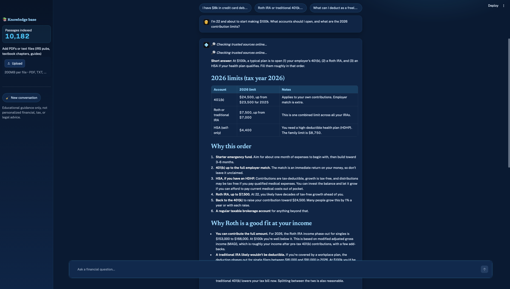
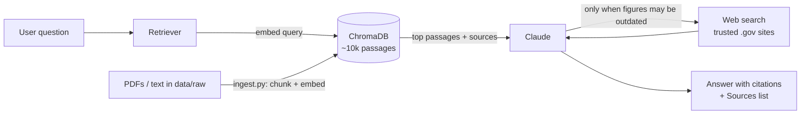

# 💼 AI Financial Advisor

A chat assistant that answers personal-finance and U.S. tax questions with **cited, source-backed answers**. It searches a library of ~10,000 passages from official government publications and a university finance textbook, checks trusted websites for figures that change every year, and uses Claude to write a clear, directional answer.

> Ask *"I'm 22 and about to make $100k. What accounts should I open?"* and it gives a prioritized plan (checking, high-yield savings, 401(k) match, Roth IRA), this year's contribution limits looked up on IRS.gov, and a **Sources** list showing exactly which documents and pages it used.

<!-- Add a screenshot: save one as docs/screenshot.png and it will show here -->


---

## Features

- **Retrieval-augmented generation (RAG).** Every question is matched against a vector database of official documents. The most relevant passages are given to Claude, which cites them inline as `[1]`, `[2]`.
- **Live lookups for changing numbers.** Contribution limits, income phase-outs, and savings rates change every year. The model can search an allow-list of trusted sites (IRS, CFPB, FDIC, SEC, SSA, and a few rate-comparison sites) and cites the pages it used.
- **Directional answers, not hedging.** It leads with a concrete recommendation, shows a worked example, then asks the 1–3 questions that would let it tailor the answer.
- **Guardrails.** No tax-evasion help, no stock picks or return guarantees, and it points to the right kind of professional for high-stakes situations.
- **Upload your own documents.** PDFs and text files can be added from the sidebar (protected by an admin password when deployed).
- **Streaming chat UI.** Built with Streamlit; answers stream in as they're written.

## How it works



1. **Ingest** (`src/ingest.py`): reads PDFs and text files, cleans the text, splits it into ~1,000-character overlapping chunks, embeds each chunk with `all-MiniLM-L6-v2` (ONNX), and stores it in ChromaDB with its source file and page number.
2. **Retrieve** (`src/retriever.py`): embeds the question, pulls the closest passages by cosine similarity, and drops weak matches so irrelevant text never reaches the model.
3. **Answer** (`src/advisor.py`): sends the passages, the conversation, and a system prompt with today's date to Claude. Web search is enabled and limited to an allow-list of domains, with a cap of 3 searches per question.

## Knowledge base

| Source | Topics |
|---|---|
| 22 IRS publications (Pub 17, 501, 590-A/B, 550, 969, 970, 334, and others) | Federal income tax, IRAs, HSAs, education credits, self-employment |
| *Principles of Finance*, OpenStax / Rice University (CC BY 4.0) | Investing, risk, time value of money |
| SEC: *Saving and Investing* | Index funds, diversification, fees, fraud |
| FDIC *Money Smart for Adults* (14 modules) | Budgeting, credit, debt, borrowing, banking |
| FDIC: *Your Insured Deposits* | Deposit insurance |
| SSA: *Retirement Benefits* | Social Security |

All sources are public-domain or openly licensed. The PDFs aren't committed to this repo; see below to download them.

### Building the knowledge base

The IRS publications download automatically with `python src/fetch_sources.py`. The rest are free but have to be downloaded by hand. Save each PDF in the folder shown, then run `python src/ingest.py`.

| Document | Where to get it | Save in |
|---|---|---|
| *Principles of Finance* (OpenStax) | [openstax.org/details/books/principles-finance](https://openstax.org/details/books/principles-finance) → "Download a PDF" | `data/raw/investing/` |
| *Saving and Investing: A Roadmap to Your Financial Security* (SEC) | Search the title on [investor.gov](https://www.investor.gov) | `data/raw/investing/` |
| *Money Smart for Adults*, participant guides for modules 1–14 (FDIC) | Search "Money Smart for Adults" on [fdic.gov](https://www.fdic.gov) | `data/raw/personal_finance/` |
| *Your Insured Deposits* (FDIC) | Search the title on [fdic.gov](https://www.fdic.gov) | `data/raw/personal_finance/` |
| *Retirement Benefits* (SSA) | [ssa.gov/pubs/EN-05-10035.pdf](https://www.ssa.gov/pubs/EN-05-10035.pdf) | `data/raw/retirement/` |

Any other PDF, `.txt` or `.md` file you add under `data/raw/` is picked up the same way.

## Tech stack

**Python 3.13** · **Claude API** (Anthropic SDK, streaming, server-side web search) · **ChromaDB** (vector store) · **ONNX Runtime** (local embeddings, no GPU or PyTorch needed) · **LangChain text splitters** · **pypdf** · **Streamlit** · **Docker** · **AWS S3** (EC2-ready)

## Run it locally

Requires Python 3.10–3.13 and an [Anthropic API key](https://console.anthropic.com/).

```bash
git clone <this repo> && cd ai-financial-advisor
python3.13 -m venv venv && source venv/bin/activate
pip install -r requirements.txt
cp .env.example .env              # then add your ANTHROPIC_API_KEY

python src/fetch_sources.py       # downloads the IRS publications
# (optional) add the other sources — see "Building the knowledge base"
python src/ingest.py              # builds the vector database (several minutes)
streamlit run src/app.py          # opens http://localhost:8501
```

Useful commands:

```bash
python src/retriever.py "roth ira income limit"   # see which passages a question retrieves
python src/advisor.py                              # chat in the terminal
python src/ingest.py --reset                       # rebuild the database from scratch
```

## Configuration

Settings live in `.env` (see `.env.example`):

| Variable | Default | Purpose |
|---|---|---|
| `ANTHROPIC_API_KEY` | — | Required |
| `CLAUDE_MODEL` | `claude-sonnet-5-5` | Model used for answers |
| `N_RESULTS` | `6` | Passages retrieved per question |
| `WEB_SEARCH` | `true` | Turn live web lookups on/off |
| `WEB_SEARCH_MAX_USES` | `3` | Max searches per question (controls cost) |
| `ADMIN_PASSWORD` | — | Required to upload documents when deployed |
| `S3_BUCKET` | — | Bucket for documents and the built database (deployment) |

## Deploying to AWS

The app is designed to run as a Docker container on EC2. S3 stores the source documents and the pre-built database, and the container pulls them on startup (`start.sh` → `src/s3_sync.py pull`). An IAM role grants the server S3 access, so no AWS keys live on the server.

```bash
python src/s3_sync.py push                          # laptop → S3
docker build -t advisor .                           # on the server
docker run -d --restart unless-stopped --env-file .env -p 80:8501 advisor
```

## Project structure

```
src/
  app.py            Streamlit chat UI
  advisor.py        Retrieval + Claude call (streaming, web search, citations)
  retriever.py      Vector search and context formatting
  ingest.py         PDF/text → chunks → embeddings → ChromaDB
  vectorstore.py    Shared ChromaDB client and ONNX embedder
  prompts.py        System prompt and guardrails
  config.py         All settings in one place
  fetch_sources.py  Downloads the IRS publication library
  s3_sync.py        Push/pull data and database to S3
data/raw/           Source documents, by category
Dockerfile, start.sh
```

## Limitations

- This is **educational guidance, not personalized financial, tax, or legal advice**, and the app says so.
- Federal tax only; state rules aren't covered.
- Answer quality depends on the documents in the library. The IRS publications should be refreshed each January (`python src/fetch_sources.py --refresh`).

## What I'd build next

- An automated test set of ~50 questions with known answers, scored on every change
- Hybrid search (keyword + vector) and a re-ranker for better retrieval
- State tax documents
- User accounts with saved conversations